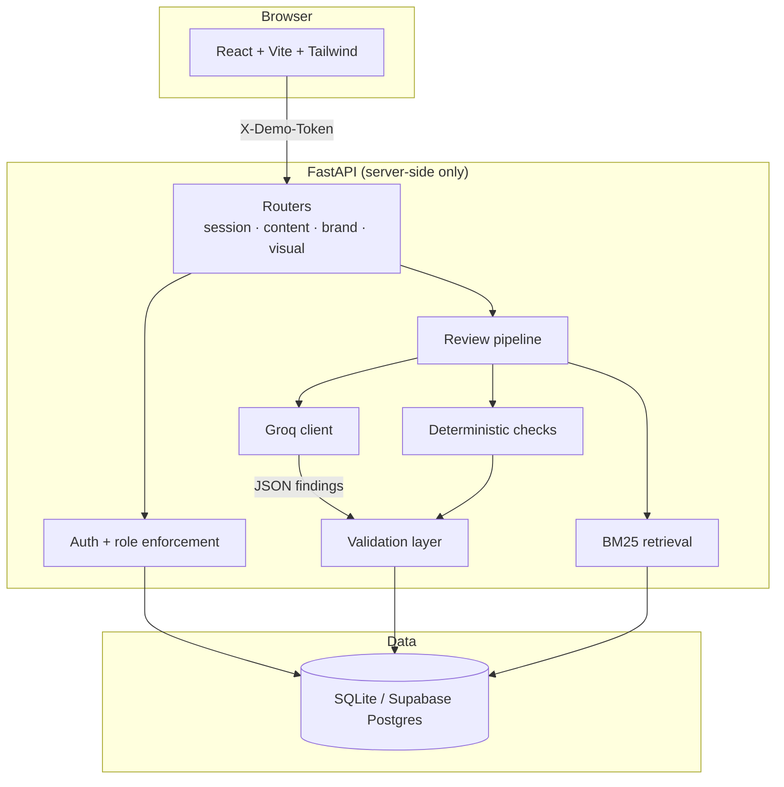

# BrandShield AI

Brand governance for content **before** it is published. Submit a draft, get
evidence-backed findings, fix them, and route that exact version to a human
approver. Nothing is auto-published and nothing is silently rewritten.

> **Live demo:** [Open BrandShield](https://brand-shield-amber.vercel.app/).
> The frontend uses the deployed API listed under [Deployment](#deployment).

---

## What it does

A creator submits content (social post, ad, email or document). BrandShield AI
checks it against the organisation's approved brand guidelines, approved facts,
terminology and visual identity. Every issue comes back with:

- the **exact affected text**
- the **rule** it breaks
- **why it matters**
- the **cited approved source**, or "Needs human verification" if no evidence exists
- a **suggested correction**

The creator accepts, edits or rejects each fix. A manager reviews, then an
approver approves or rejects that specific version.

---

## Quick start

### 1. Backend

```powershell
cd backend
python -m venv .venv
.venv\Scripts\python.exe -m pip install -r requirements.txt
.venv\Scripts\python.exe -m uvicorn app.main:app --host 127.0.0.1 --port 8000
```

The database is created and seeded automatically on first start.

- API: http://localhost:8000
- OpenAPI docs: http://localhost:8000/docs
- Health: http://localhost:8000/health

### 2. Frontend

```powershell
cd frontend
npm install
npm run dev
```

Open http://localhost:5173 and click **Try as Creator**.

---

## Environment variables

Copy `.env.example` to `.env` in the repo root. `.env` is gitignored.

| Variable | Required | Purpose |
|---|---|---|
| `DATABASE_URL` | no | Postgres/Supabase URL. Blank = local SQLite file. |
| `GROQ_API_KEY` | no | Enables AI analysis. Without it, deterministic checks still run. |
| `GROQ_MODEL` | no | Defaults to `openai/gpt-oss-120b`. |
| `LLM_TIMEOUT_SECONDS` | no | Defaults to 25. |
| `SUPABASE_URL` / `SUPABASE_ANON_KEY` / `SUPABASE_JWT_SECRET` | no | Optional real email auth. |
| `CORS_ORIGINS` | no | Comma-separated allowed origins. |
| `SEED_ON_START` | no | Defaults to `true`. |

**No secrets are committed.** `.env` is in `.gitignore` and was verified with
`git check-ignore`.

---

## Architecture



### Review pipeline

1. **Extract** text and split into sentence spans with character offsets.
2. **Deterministic checks** (pure Python, no network): prohibited terms, wrong
   product names, required disclaimers, banned phrases, exact fact mismatches
   (protein, price, launch date, certifications), unsupported ranking claims.
3. **Retrieval**: BM25 over approved, in-force passages, filtered by workspace
   *before* ranking.
4. **LLM analysis** (Groq, JSON mode): tone, messaging and claim support.
5. **Validation**: every LLM finding is checked — the cited passage must exist,
   be approved, be in force and belong to the same workspace. Affected text must
   actually appear in the draft. Unsupported claims are never called "false".
6. **Merge**, de-duplicate, sort by severity, store.

If the LLM fails or times out, steps 2, 3 and 6 still run and the UI says so.

---

## Demo script (under 2 minutes)

1. Open the landing page → click **Try as Creator**.
2. Click **New submission** → load the **LinkedIn launch post** sample.
3. Press **Run review**. You get 8 findings, each with a cited source.
4. Click a highlight in the draft to jump to its finding.
5. Click **Accept fix** on two or three findings — note the confirmation bar.
6. Press **Apply accepted fixes → new version**. A new version is created.
7. Press **Send to Manager**.
8. Click **Switch role** → **Try as Manager** → open the item → **Send to Approver**.
9. **Switch role** → **Try as Approver** → **Open approval decision** → **Approve**.

---

## Roles

| Role | Can author | Can review | Can approve |
|---|---|---|---|
| Creator | ✅ | — | — |
| Manager | — | ✅ | — |
| Approver | — | — | ✅ |

Roles are enforced **in the backend**, not only the UI. Managers and approvers
cannot create submissions, so the person who writes a draft is never the person
who approves it.

---

## Testing

```powershell
cd backend
.venv\Scripts\python.exe -m pytest tests -v
```

See [COMPLETED_FEATURES.md](./COMPLETED_FEATURES.md) for an honest list of what
works and what is partial.

---

## Deployment

The app is deployed:

- **Frontend:** [https://brand-shield-amber.vercel.app/](https://brand-shield-amber.vercel.app/)
- **Backend API:** [https://brandshield-api-eweqbqd8bpbwhbcn.centralindia-01.azurewebsites.net/](https://brandshield-api-eweqbqd8bpbwhbcn.centralindia-01.azurewebsites.net/)

For a separate deployment, set `VITE_API_URL` on the frontend to the backend
URL, and `CORS_ORIGINS` on the backend to the frontend URL. Use `/health` as the
keep-warm ping.

---

## Disclosure

**Libraries**

- Backend: FastAPI, Pydantic, uvicorn, rank_bm25, httpx, PyMuPDF, python-docx, Pillow, numpy, psycopg
- Frontend: React, Vite, Tailwind CSS, React Router

**APIs**

- Groq (`openai/gpt-oss-120b`) for LLM analysis, called server-side only
- Supabase (optional) for Postgres, Auth and Storage

**AI assistance**

This project was built with AI assistance (GitHub Copilot). All code was
reviewed, run and verified against a live server during development.

**Not used**

- OCR — deliberately skipped. Scanned PDFs are rejected with a clear message
  rather than silently returning nothing.
- Local embeddings — Groq has no embeddings endpoint; BM25 was sufficient.

---

## Licence

Demo project. All company data ("Northwind Foods") is fictional.
