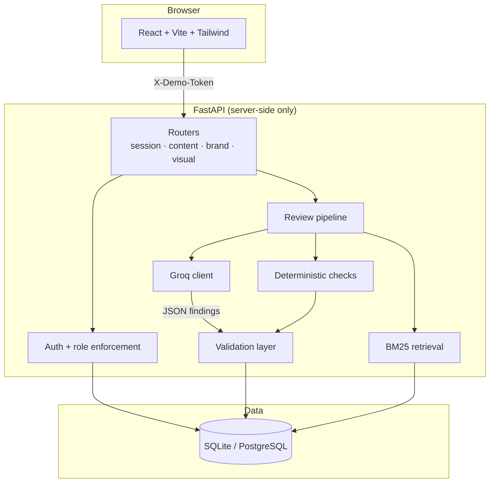

# BrandShield AI

Brand governance for content **before** it is published. Submit a draft, get
evidence-backed findings, fix them, and route that exact version to a human
approver. Nothing is auto-published and nothing is silently rewritten.

> **Live demo:** [Open BrandShield](https://brand-shield-amber.vercel.app/).
> The frontend uses the deployed API listed under [Deployment](#deployment).
>
> **Round 3 submission:** See [the complete submission packet](./SUBMISSION.md)
> and [download the product PDF](./BrandShield_Product.pdf).

---

## What it does

A creator submits content (social post, ad, email or document). BrandShield AI
checks it against the organisation's approved brand guidelines, approved facts,
terminology and visual identity. Every issue comes back with:

- the **exact affected text**
- the **rule** it breaks
- **why it matters**
- the **cited approved source**, or "Needs human verification" if no evidence exists
- a **suggested correction**

The creator accepts, edits or rejects each fix. A manager reviews, then an
approver approves or rejects that specific version.

---

## Quick start

### Prerequisites

- Python 3.13 (the version used for verification)
- Node.js 18 or newer and npm

Clone the repository and open a PowerShell terminal at its root:

```powershell
git clone https://github.com/krishnabhatiadesigns/BrandShield.git
cd BrandShield
Copy-Item .env.example .env
```

The `.env` file is optional for local use. Leave `GROQ_API_KEY` blank to run
deterministic checks without external AI calls. `.env.example` enables the
fictional local demo. Production deployments should disable demo access and
configure Supabase Auth as described below.

### 1. Backend

```powershell
Set-Location backend
python -m venv .venv
.venv\Scripts\python.exe -m pip install -r requirements.txt
.venv\Scripts\python.exe -m uvicorn app.main:app --host 127.0.0.1 --port 8000
```

The database is created and seeded automatically on first start.

- API: http://localhost:8000
- OpenAPI docs: http://localhost:8000/docs
- Health: http://localhost:8000/health

### 2. Frontend

```powershell
Set-Location frontend
npm ci
npm run dev
```

Open http://localhost:5173. The anonymous demo role selector is enabled by
default; set `VITE_DEMO_AUTH_ENABLED=false` only when you want to hide it.
Visitors choose a demo persona (no employee account or password) to enter the
fictional seeded workspace. Vercel rewrites app routes to the SPA entry point so
deep links work when opened directly.

### Business sign-in with Supabase

The application supports invitation-only Supabase email/password accounts.
Configure Supabase Auth to require email confirmation, disable public sign-ups,
and allow the exact frontend URL ending in `/set-password` as a redirect URL.
The invite link lets the employee set their password; the sign-in page also
supports password recovery. Configure Supabase's minimum password length to at
least 12 characters to match the password setup form.

Set these backend variables in the hosting provider:

| Variable | Purpose |
|---|---|
| `SUPABASE_URL` | Supabase project URL (used for issuer and JWKS verification). |
| `SUPABASE_SERVICE_ROLE_KEY` | Server-only key used to invite, ban and unban users. Never put this in frontend variables. |
| `SUPABASE_JWT_SECRET` | Optional legacy HS256 verification secret. Prefer Supabase's asymmetric JWKS keys and leave blank when possible. |
| `APP_FRONTEND_URL` | Exact frontend origin used for invitation redirects. |
| `DEMO_AUTH_ENABLED` | Defaults to `true` for the public hackathon demo; set to `false` to disable demo personas. |

Set these frontend build variables:

| Variable | Purpose |
|---|---|
| `VITE_SUPABASE_URL` | The same Supabase project URL. |
| `VITE_SUPABASE_PUBLISHABLE_KEY` | Supabase publishable key (or legacy anon key). This key is safe for browser use. |
| `VITE_API_URL` | Backend origin when the API is hosted separately. |
| `VITE_DEMO_AUTH_ENABLED` | Optional. Set to `false` to hide public demo personas. |
| `VITE_ORGANIZATION_CREATION_ENABLED` | Exposes first-organization onboarding; only useful when backend onboarding is enabled. |

For local Supabase sign-in, create `frontend/.env.local` with the frontend
variables and set `DEMO_AUTH_ENABLED=false` in the backend `.env`.
For controlled self-service organization setup, set
`ALLOW_ORGANIZATION_CREATION=true` on the backend and
`VITE_ORGANIZATION_CREATION_ENABLED=true` in the frontend build environment.
After a verified employee creates an organization, they become its first admin
and can create brand workspaces and invite staff. Turn self-service creation off
after onboarding if registration should remain invitation-only.

#### First organization administrator

For self-service onboarding, temporarily enable `ALLOW_ORGANIZATION_CREATION`
and `VITE_ORGANIZATION_CREATION_ENABLED`; any verified account not already in
a workspace can create its organization and becomes its first administrator.
Disable the backend setting afterward if new organization creation should stop.

Alternatively, create and verify an administrator in Supabase Auth, then insert
that user into a workspace membership using a trusted database connection.
Replace the placeholders; do not expose this SQL to end users:

```sql
INSERT INTO memberships
    (workspace_id, user_id, email, display_name, role, is_active, created_at)
SELECT id, '<SUPABASE_USER_UUID>', lower('<ADMIN_EMAIL>'), '<ADMIN_NAME>',
       'admin', 1, CURRENT_TIMESTAMP
FROM workspaces
WHERE slug = 'northwind-foods';
```

The admin can then invite employees and assign their workflow role from
**Team access**. Deactivating a member blocks BrandShield API access immediately
and also bans the account at Supabase. Each membership is tied to one brand workspace; admins can create additional
brands inside their organization and explicitly invite employees into each
brand. The workspace switcher only shows workspaces the signed-in employee is
authorized to access.

---

## Environment variables

Copy `.env.example` to `.env` in the repo root. `.env` is gitignored.

| Variable | Required | Purpose |
|---|---|---|
| `DATABASE_URL` | no | Generic PostgreSQL connection URL. Blank = local SQLite file. |
| `GROQ_API_KEY` | no | Enables AI analysis. Without it, deterministic checks still run. |
| `GROQ_MODEL` | no | Defaults to `openai/gpt-oss-120b`. |
| `LLM_TIMEOUT_SECONDS` | no | Defaults to 25. |
| `CORS_ORIGINS` | no | Comma-separated exact allowed origins; `*` is rejected. |
| `DEMO_WORKSPACE_SLUG` | no | Defaults to `northwind-foods`. |
| `DEMO_SESSION_TTL_HOURS` | no | Demo-session lifetime; defaults to 12 hours. |
| `DEMO_AUTH_ENABLED` | no | Local example enables demo role selection; disable in production. |
| `SUPABASE_URL` | no | Enables Supabase access-token verification when configured. |
| `SUPABASE_JWT_SECRET` | no | Optional verification key for legacy HS256 JWTs. |
| `SUPABASE_SERVICE_ROLE_KEY` | no | Server-only member invitations and activation changes. |
| `APP_FRONTEND_URL` | no | Frontend origin for Supabase invite redirects. |
| `ALLOW_ORGANIZATION_CREATION` | no | Enables verified-account organization onboarding; default `false`. |
| `SEED_ON_START` | no | Defaults to `true`. |

**No secrets are committed.** `.env` is in `.gitignore` and was verified with
`git check-ignore`.

---

## Architecture



### Review pipeline

1. **Extract** text and split into sentence spans with character offsets.
2. **Deterministic checks** (pure Python, no network): prohibited terms, wrong
   product names, required disclaimers, banned phrases, exact fact mismatches
   (protein, price, launch date, certifications), unsupported ranking claims.
3. **Retrieval**: BM25 over approved, in-force passages, filtered by workspace
   *before* ranking.
4. **LLM analysis** (Groq, JSON mode): enabled, content-applicable brand rules,
   tone, messaging and claim support. Managers/admins can create and version
   rules in the Brand profile; AI findings can cite a rule and its exact version.
5. **Validation**: every LLM finding is checked — the cited passage must exist,
   be approved, be in force and belong to the same workspace. Affected text must
   actually appear in the draft. Unsupported claims are never called "false".
6. **Merge**, de-duplicate, sort by severity, store.

If the LLM fails or times out, steps 2, 3 and 6 still run and the UI says so.

---

## Demo script (under 2 minutes)

1. Open the landing page → click **Try as Creator**.
2. Click **New submission** → load the **LinkedIn launch post** sample.
3. Press **Run review**. You get 8 findings, each with a cited source.
4. Click a highlight in the draft to jump to its finding.
5. Click **Accept fix** on two or three findings — note the confirmation bar.
6. Press **Apply accepted fixes → new version**. A new version is created.
7. Press **Send to Manager**.
8. Click **Switch role** → **Try as Manager** → open the item → **Send to Approver**.
9. **Switch role** → **Try as Approver** → **Open approval decision** → **Approve**.

---

## Roles

| Role | Can author | Can review | Can approve |
|---|---|---|---|
| Creator | ✅ | — | — |
| Manager | — | ✅ | — |
| Approver | — | — | ✅ |
| Admin | ✅ | ✅ | ✅ |

Roles are enforced **in the backend**, not only the UI. Managers and approvers
cannot create submissions, so the person who writes a draft is never the person
who approves it.

The local demo role-selection flow is not production identity management;
anyone can select a demo role when demo access is enabled. Business accounts
use Supabase-verified access tokens and active workspace membership records.
Supabase manages passwords, recovery and email verification; BrandShield keeps
roles in its own membership table. Demo sessions expire after 12 hours and are
revoked on sign-out.

Organizations can contain multiple brand workspaces. Members can switch only
between workspaces where they have an active membership; admins invite staff
separately into each brand. Existing workspaces are migrated into individual
legacy organizations.

### Structured brand policy

Managers and admins can add policy rules in the Brand profile, choose category,
severity, mandatory/advisory status, content applicability, effective date,
examples, and an optional approved source passage. Updates are preserved as
immutable numbered versions. Only enabled rules matching the submission type
are included in AI analysis. A finding citing a policy rule records its version
and text so later edits do not rewrite the review evidence. Rules without an
approved passage are not accepted as factual evidence.

---

## Testing

```powershell
Set-Location backend
.venv\Scripts\python.exe -m pytest tests -v
```

The suite includes focused checks for evidence validation, minimal revision
spans, visual colour/contrast results, workflow transitions, duplicate actions,
invalid input, demo-session expiry/revocation, CORS allowlisting and
workspace-scoped retrieval. See [COMPLETED_FEATURES.md](./COMPLETED_FEATURES.md)
for an honest list of what works and what remains partial.

Build the frontend with:

```powershell
Set-Location frontend
npm ci
npm run build
```

The final submission and roadmap are in [SUBMISSION.md](./SUBMISSION.md).
Regenerate the product PDF after editing that file:

```powershell
Set-Location backend
..\.venv\Scripts\python.exe ..\scripts\build_submission_pdf.py
```

---

## Deployment

The app is deployed:

- **Frontend:** [https://brand-shield-amber.vercel.app/](https://brand-shield-amber.vercel.app/)
- **Backend API:** [https://brandshield-api-eweqbqd8bpbwhbcn.centralindia-01.azurewebsites.net/](https://brandshield-api-eweqbqd8bpbwhbcn.centralindia-01.azurewebsites.net/)
- **Source repository:** [https://github.com/krishnabhatiadesigns/BrandShield](https://github.com/krishnabhatiadesigns/BrandShield)

For a separate deployment, set `VITE_API_URL` on the frontend to the backend
URL, and `CORS_ORIGINS` on the backend to the frontend's exact origin (for
example, `https://your-site.example`). Wildcard origins are rejected. Use
`/health` as the keep-warm ping.

The live frontend and backend `/health` endpoint were checked on 18 November
2026. A reachable URL does not replace testing the full workflow on the target
deployment after configuration changes.

---

## Disclosure

**Libraries**

- Backend: FastAPI, Pydantic, uvicorn, rank_bm25, httpx, PyMuPDF, python-docx, Pillow, numpy, psycopg
- Frontend: React, Vite, Tailwind CSS, React Router

**APIs**

- Groq (`openai/gpt-oss-120b`) for LLM analysis, called server-side only
- PostgreSQL is supported as a generic database option; local development
  defaults to SQLite.

**AI assistance**

This project was built with AI assistance (GitHub Copilot). All code was
reviewed, run and verified against a live server during development.

**Not used**

- OCR — deliberately skipped. Scanned PDFs are rejected with a clear message
  rather than silently returning nothing.
- Local embeddings — Groq has no embeddings endpoint; BM25 was sufficient.

---

## Licence

Demo project. All company data ("Northwind Foods") is fictional.
