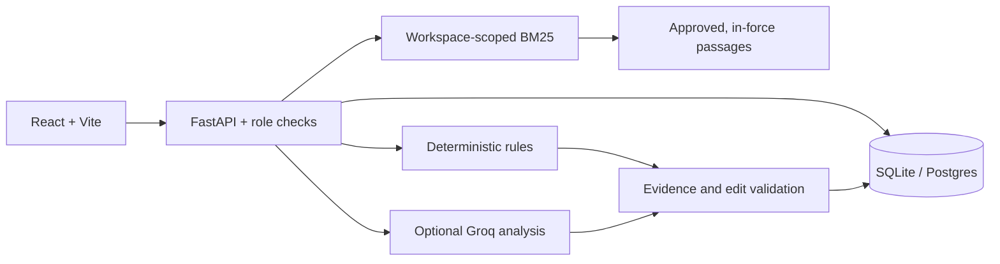

# BrandShield AI — Round 3 submission

**Team:** We Code Coders
**Product:** BrandShield AI
**Submission date:** 18 November 2026

## Submission links

- **Working product:** [BrandShield AI demo](https://brand-shield-amber.vercel.app/)
- **Source repository:** [krishnabhatiadesigns/BrandShield](https://github.com/krishnabhatiadesigns/BrandShield)
- **Backend health:** [API health check](https://brandshield-api-eweqbqd8bpbwhbcn.centralindia-01.azurewebsites.net/health)
- **Product PDF:** [BrandShield_Product.pdf](./BrandShield_Product.pdf)
- **Run instructions:** [README.md](./README.md)

The public demo and API health endpoint were reachable on 18 November 2026.
The health endpoint reported the database up and AI analysis enabled. The demo
uses fictional Northwind Foods data.

## Product

BrandShield reviews marketing drafts against a workspace's approved brand
guidelines, facts and terminology before publication. It combines deterministic
checks with optional evidence-grounded AI analysis. Each finding identifies the
affected text, rule, explanation, evidence status and (when safe) a suggested
replacement. People decide what to change; the product never auto-publishes.

## Complete feature list

### Built and working

- Create submissions by pasting text or uploading text-based PDF, DOCX, TXT or Markdown.
- Choose social, ad, email or document content types; load sample drafts.
- Run deterministic brand checks without an AI service.
- Optionally run Groq analysis with retrieval over approved, in-force passages.
- Scope retrieval and stored records to the signed-in workspace.
- Create organizations and multiple brand workspaces; switch only among brands with active membership.
- Configure versioned, content-applicable brand policy rules and retain the exact cited rule version on AI findings.
- Validate AI findings against the draft and approved sources; downgrade invalid
  evidence and remove unsafe suggestions.
- Show finding severity, evidence, exact affected text and suggested changes.
- Accept, edit or reject individual findings; create a new version from accepted
  fixes without silently altering the original.
- Edit drafts directly, preserve the version history and record audit events.
- Route work from creator to manager to approver; send work back with a required
  note and show that note to the intended next reviewer.
- Approve, request changes or reject a specific version. Require explicit
  sign-off before approving unresolved high-severity findings.
- Add comments, review prior versions and inspect the audit trail.
- Maintain company context, guidelines/passages, approved and prohibited terms,
  facts, disclaimers and brand palette.
- Check palette similarity with CIE76 colour difference and text contrast with
  WCAG 2.1 relative luminance.
- Use responsive screens, loading/error states, empty states and retry controls.

### Explicit limitations

- OCR is not implemented; scanned PDFs without selectable text are rejected.
- Visual checking accepts hex colours; it does not inspect uploaded images.
- Supabase email/password authentication, invitation, recovery and workspace
  member role/access controls and organization/brand workspaces are implemented
  but require provider configuration and live verification. Guideline uploads
  are parsed in memory and are not persisted to object storage.
- Analytics, email notifications and publishing integrations are not built.
- The planned labelled accuracy set was not completed. No precision/recall or
  accuracy score is claimed.

## Technical architecture and implementation

The frontend is React 18, TypeScript, Vite and Tailwind CSS. It calls a FastAPI
backend. SQLite is the local default; a generic PostgreSQL adapter is available.
The optional Groq API is called only from the backend.

The review path extracts text and offsets, runs deterministic rules, retrieves
approved and in-force passages after applying workspace filters, optionally
requests AI findings, validates every citation and replacement, deduplicates
the results, then persists findings and run metadata. A failed or disabled LLM
does not prevent deterministic findings from being returned.

The workflow stores each draft as a version and ties approvals to that exact
version. Backend role checks enforce separation of duties. Re-running a review
refreshes findings without moving a version backwards in the workflow; editing
creates a new version and invalidates the old approval for the current draft.
Actions are recorded in an audit trail.

See [TECH_AND_IMPLEMENTATION.md](./TECH_AND_IMPLEMENTATION.md) for the detailed
pipeline, data model, workflow states and calculations.

## Improvements delivered against the three Round 2 commitments

1. **Evidence-backed verification hardening.** AI citations must resolve to an
   approved, in-force passage in the same workspace. Invalid citations cannot
   support or contradict a claim. Findings whose text is absent are discarded;
   suggestions that introduce unapproved numbers are removed. Regression
   coverage is in `backend/tests/test_round3_readiness.py`.
2. **Context-preserving corrections.** A suggestion replaces only its stored
   span. Replacements apply from the end of the draft backwards; overlapping or
   stale spans are skipped rather than corrupting text. The regression suite
   checks accepted fixes, re-run decision preservation, overlapping edits and
   stale spans.
3. **Visual brand compliance.** The visual endpoint compares colours in CIE76
   Lab space and checks WCAG 2.1 contrast ratios. Regression coverage checks an
   on-palette colour, an off-palette colour, below-AA contrast and malformed
   colour input.

These are the three committed improvements; no substitute improvements are
claimed.

### Additional reliability work after Round 2

- Demo sessions expire after 12 hours by default; logout revokes tokens
  server-side, expired sessions are rejected, and stale sessions are cleaned on
  a new login.
- CORS allows explicit configured origins only; wildcard origins are rejected.
- Retrieval regression tests confirm results are restricted to approved,
  in-force documents in the active workspace.
- Generated local database and TypeScript build artifacts are ignored rather
  than tracked in the source repository.

## Testing details

Verified locally on 18 November 2026:

- From `backend\`, `.venv\Scripts\python.exe -m pytest tests -v` — **46 tests passed**.
  Coverage includes evidence validation, visual checks, workflow transitions,
  re-run decision preservation, exact-version approval, reviewer role
  restrictions, stale/overlapping edits, duplicate actions, whitespace-only
  submission rejection, session expiry/revocation, CORS allowlisting and
  workspace-scoped retrieval.
- `npm run build` in `frontend` — TypeScript check and Vite production build
  passed.
- The live frontend loaded and the deployed API `/health` endpoint returned
  `status: ok` and `database: up`.
- End-to-end workflow tests use an in-memory SQLite database and a deterministic
  fake review result; they do not depend on network availability or make live
  submissions.

## Product roadmap

1. **Structured policy management:** add direct deterministic evaluation for
   configurable rules and expand policy-change approval/governance controls.
2. **Reliable document storage:** persist uploads in private object storage with
   retention controls, file limits and clear download permissions.
3. **Visual asset workflow:** add explicit image-region selection and human
   verification before palette checks; consider OCR only after quality can be
   measured on a labelled test set.
4. **Evaluation and evidence quality:** build a reviewed, labelled corpus and
   report precision and recall by rule category. Only then compare BM25 with
   hybrid/vector retrieval and evaluate calibrated confidence and
   citation-backed contradiction detection.
5. **Team operations:** add analytics, audit exports and notifications based on
   user feedback.
6. **Integrations:** consider publishing-platform connections only after the
   human approval and version controls are proven in production.

## Reproduce locally

Follow the prerequisites, environment setup and two-terminal startup steps in
the [README](./README.md). Local checks run without `GROQ_API_KEY`; configure it
only when testing optional AI analysis.
