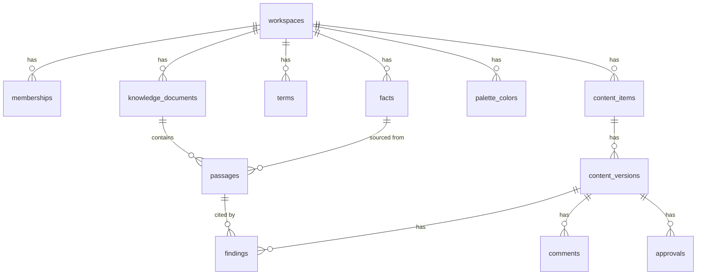
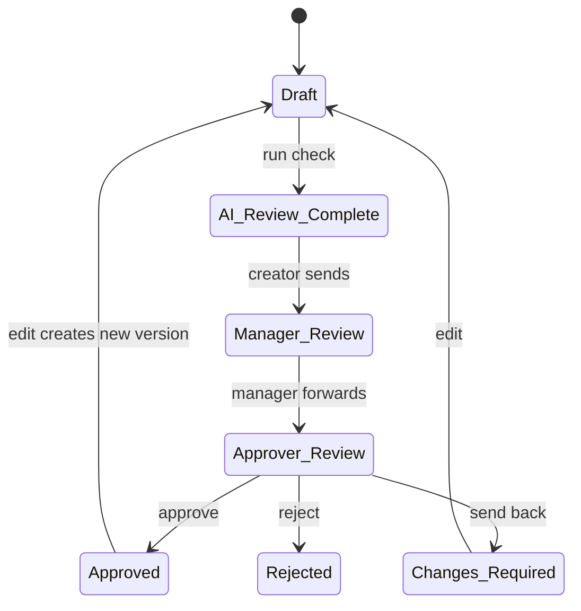

# TECH_AND_IMPLEMENTATION

Stack, pipeline, schema, retrieval and validation.

---

## Stack

| Layer | Choice | Notes |
|---|---|---|
| Frontend | React 18 + Vite 5 + Tailwind 3 | TypeScript, React Router 6 |
| Backend | Python 3.13 + FastAPI | Typed Pydantic models, OpenAPI at `/docs` |
| Database | SQLite (dev) / Supabase Postgres (prod) | One DDL template renders for both |
| LLM | Groq `openai/gpt-oss-120b` | JSON mode, server-side only |
| Retrieval | `rank_bm25` (BM25Okapi) | Workspace-filtered before ranking |
| Extraction | PyMuPDF (PDF), python-docx (DOCX), plain text | |
| Visual | Pillow/numpy for colour maths | CIE76 ΔE + WCAG 2.1 contrast |

### Why SQLite locally

The database layer (`app/db.py`) speaks both SQLite and Postgres through one
interface. All SQL uses `?` placeholders, rewritten to `%s` for Postgres. This
let the whole workflow be built and verified before Supabase credentials were
available, with no code changes needed to switch.

---

## Review pipeline

`app/pipeline.py` orchestrates five stages.

### 1. Extraction and segmentation

`app/text.py` splits the body into sentence spans that carry **character
offsets into the original text**. This is what makes highlighting exact — the UI
never has to guess where a finding sits.

### 2. Deterministic checks

`app/checks/deterministic.py`. Pure Python, no network, always runs.

| Check | Method |
|---|---|
| Prohibited terms | Word-boundary regex, case-insensitive, longest-match wins |
| Wrong product names | Regex candidate extraction + `difflib` similarity ≥ 0.55 |
| Required disclaimers | Normalised substring test per content type |
| Banned phrases | Fixed list with word boundaries |
| All-caps / exclamation / emoji | Regex, with an allow-list for real acronyms (FSSAI, USDA, INR…) |
| Protein / price / date | Regex extraction, numeric comparison against `facts` |
| Certifications | Claim list vs approved certification fact |
| Ranking claims | Regex → `needs_verification`, never `contradicted` |

**Suggestion contract:** `suggestion` replaces exactly `[span_start, span_end)`.
This is enforced in the revise step, which also skips overlapping spans and
verifies the stored span still matches the text before applying.

### 3. Retrieval

`app/retrieval.py`. Passages are loaded with a SQL filter that requires:

```sql
WHERE p.workspace_id = ?
  AND d.workspace_id = ?
  AND d.status = 'approved'
  AND (d.effective_date IS NULL OR d.effective_date <= date('now'))
```

Only then is BM25 built. A passage from another workspace can never be returned,
even if it would score highest.

### 4. LLM analysis

`app/llm.py`. Groq chat completions with `response_format: json_object`.

The prompt gives the model the draft, the retrieved passages with their ids, and
the deterministic findings already raised (so it does not repeat them). It
returns findings matching a fixed schema.

The client **never raises into the request path**. It returns an `LLMResult`
with `ok`, `findings` and a human-readable `message`, so the pipeline can degrade
to deterministic-only and the UI can explain why.

### 5. Validation

`app/validation.py` is the trust boundary. Every LLM finding must survive:

1. **Affected text must exist** in the draft — offsets are recomputed, never trusted.
2. **Cited passage must be valid** — exists, approved, in force, same workspace.
   An invalid citation downgrades `supported`/`contradicted` to `needs_verification`.
3. **Evidence consistency** — claiming support without a valid citation is
   downgraded.
4. **Suggestion safety** — a suggestion that introduces numbers not present in the
   affected text and not in the approved facts is removed.
5. **Category and severity** are clamped to known values.

Then `merge_findings` de-duplicates (exact-span match, or ≥60% overlap within the
same category) and sorts by severity.

---

## Data model



Key tables:

- **`findings`** — `version_id`, `category`, `severity`, `span_start/end`,
  `affected_text`, `rule`, `explanation`, `source_passage_id` (nullable),
  `evidence_status`, `confidence`, `suggestion`, `creator_decision`,
  `edited_text`, `detector`.
- **`approvals`** — `version_id`, `decision`, `reason`, `reviewer`,
  `high_severity_signoff`, `created_at`. Tied to one version.
- **`audit_events`** — every action with actor, entity and detail.

### Workspace isolation

Every query in every router filters on `workspace_id` taken from the resolved
principal, never from the request body. The retrieval SQL filters on both
`passages.workspace_id` and `knowledge_documents.workspace_id`.

---

## Status machine



Re-running a check is an **analysis refresh, not a transition** — it preserves
the current status so an approver who re-runs does not lose their turn.

---

## Auth

`app/auth.py`. Two paths, both resolved server-side:

- **Demo sessions** — `POST /api/demo/session` with a role returns an opaque
  token stored in `demo_sessions`, mapped to a real `memberships` row. Role checks
  are identical to production.
- **Supabase** — HS256 JWT verified with `SUPABASE_JWT_SECRET`, mapped to a
  membership by email.

`require_role(...)` is a FastAPI dependency applied per route.

---

## Visual checks

`app/routers/visual.py`.

- **Palette similarity**: sRGB → linear → XYZ (D65) → CIE Lab, then CIE76 ΔE.
  ΔE < 10 is treated as on-brand.
- **Contrast**: WCAG 2.1 relative luminance and `(L1+0.05)/(L2+0.05)`.

Both are real calculations, not heuristics.
